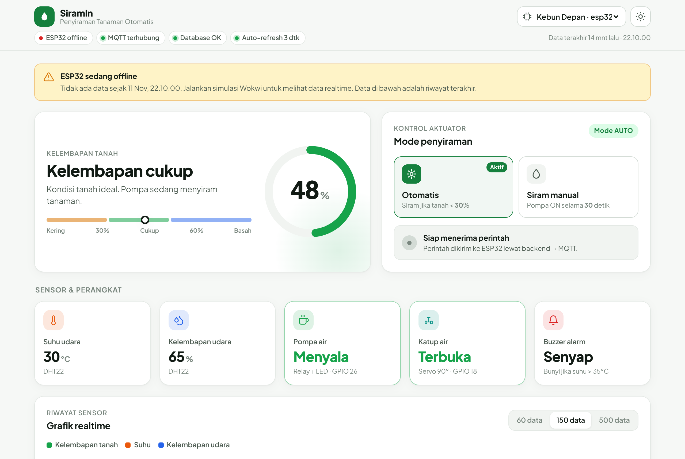
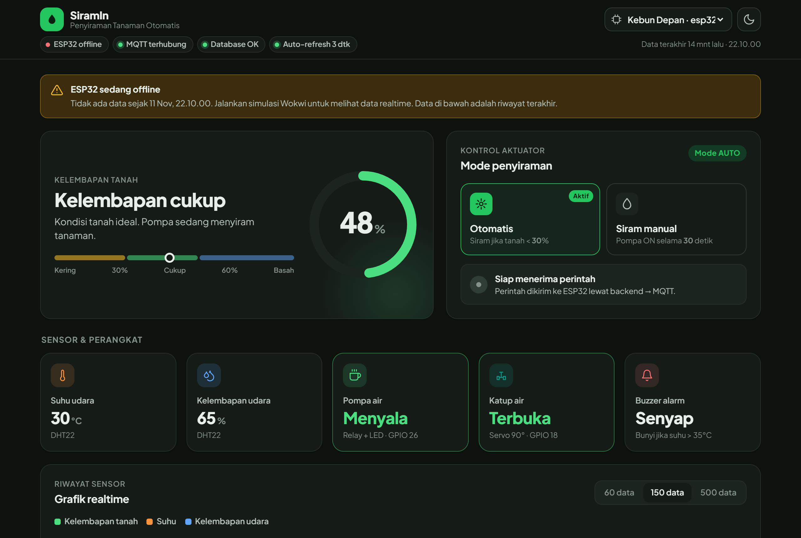
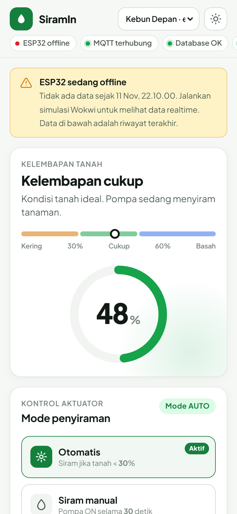
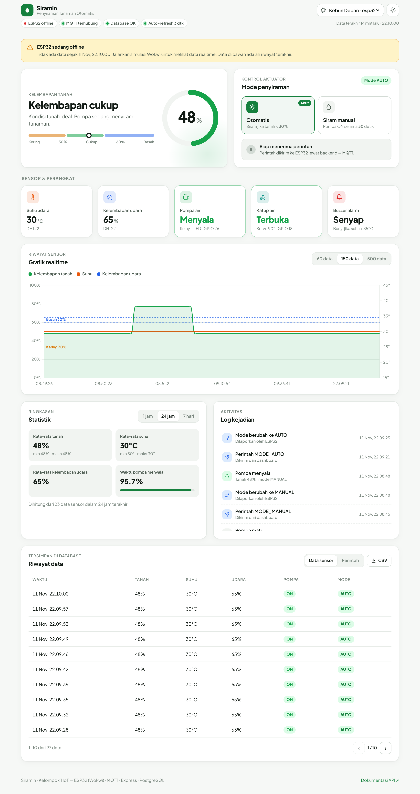
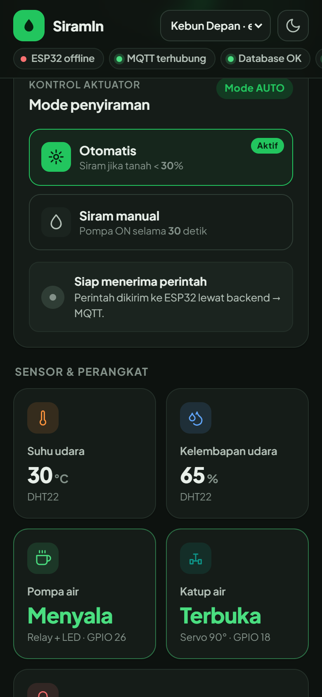
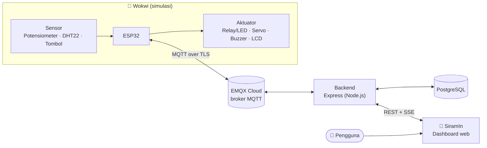
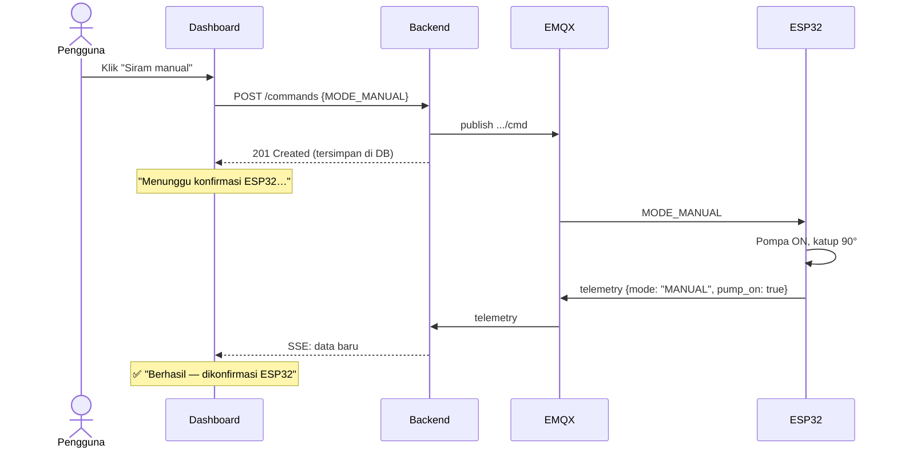

<div align="center">


# SiramIn

### Dashboard Sistem Penyiraman Tanaman Otomatis

Monitoring kelembapan tanah, suhu, dan kelembapan udara secara realtime,
serta kontrol pompa air dari web untuk ESP32 yang disimulasikan di Wokwi.


<br>


[Fitur](#-fitur) •
[Arsitektur](#-arsitektur-sistem) •
[Instalasi](#-cara-menjalankan) •
[Panduan demo](#-panduan-penggunaan--demo) •
[API](#-endpoint-api-yang-dipakai) •
[Konfigurasi](#%EF%B8%8F-konfigurasi)

</div>

---

## 📸 Tampilan

<p align="center">
  
</p>

<table>
  <tr>
    <td width="68%"></td>
    <td width="32%"></td>
  </tr>
  <tr>
    <td align="center"><sub>Mode gelap</sub></td>
    <td align="center"><sub>Tampilan ponsel</sub></td>
  </tr>
</table>

<details>
<summary><b>Lihat tangkapan layar halaman penuh</b></summary>
<br>
<p align="center"></p>
<p align="center"></p>
</details>

---

## 📖 Tentang Proyek

**SiramIn** adalah aplikasi web (front-end) untuk tugas proyek kelompok **Integrasi IoT dengan Aplikasi Web**,
tema nomor 1: *Sistem Penyiraman Tanaman Otomatis dengan Monitoring Kelembapan dan Suhu*.

Masalah yang diselesaikan: penyiraman manual bergantung pada kebiasaan, sehingga tanaman bisa kekurangan
atau kelebihan air. Sistem ini membaca kondisi tanah dan udara, menyiram otomatis saat tanah kering,
dan menampilkan semuanya di dashboard yang bisa dibuka dari laptop maupun ponsel.

| Komponen | Peran |
|---|---|
| **Potensiometer** (pengganti soil moisture) | Input kelembapan tanah 0–100% |
| **DHT22** | Input suhu dan kelembapan udara |
| **Push button** | Input mode manual |
| **Relay + LED** | Aktuator pompa air |
| **Servo** | Aktuator katup air (0° tutup, 90° buka) |
| **Buzzer** | Alarm suhu tinggi |
| **LCD 16x2 I2C** | Tampilan lokal |

> Repositori ini berisi **front-end**. Backend (Express + PostgreSQL + MQTT) dan firmware ESP32 ada di
> [**Radjartha/nodejs-wokwi**](https://github.com/Radjartha/nodejs-wokwi).

---

## ✨ Fitur

Semua **fitur minimum aplikasi web** dari modul tugas terpenuhi:

| Fitur di modul | Implementasi di SiramIn |
|---|---|
| 📊 **Dashboard monitoring** | Satu halaman pusat pemantauan dengan update realtime (Server-Sent Events + auto-refresh 3 detik) |
| 🌡️ **Nilai sensor & status** | Gauge kelembapan tanah dengan zona *kering / cukup / basah*, suhu, kelembapan udara, plus status **ESP32 online/offline**, **MQTT**, dan **database** |
| 🎛️ **Kontrol aktuator** | Tombol **Otomatis** (`MODE_AUTO`) dan **Siram manual 30 detik** (`MODE_MANUAL`), dikirim ke ESP32 lewat MQTT |
| 🔔 **Indikator perintah** | Status bertahap: *mengirim* → *menunggu konfirmasi ESP32* → ✅ **berhasil** / ❌ **gagal** / ⚠️ **ESP32 tidak merespons** |
| 🗄️ **Penyimpanan data** | Tabel riwayat data sensor & riwayat perintah dari PostgreSQL, dengan paginasi dan **ekspor CSV** |
| 🖥️ **Tampilan informatif** | Status pompa, katup, dan buzzer, hitung mundur mode manual, grafik, statistik, dan log kejadian |

Fitur tambahan:

- 📈 **Grafik realtime** kelembapan tanah, suhu, dan kelembapan udara dengan garis ambang 30% dan 60%
- 📉 **Statistik** rata-rata, minimum, maksimum, dan persentase waktu pompa menyala (1 jam / 24 jam / 7 hari)
- 📝 **Log kejadian** otomatis: pompa menyala/mati, perubahan mode, alarm suhu, perintah dari dashboard
- ✅ **Konfirmasi dua arah**: perintah baru dianggap berhasil setelah ESP32 benar-benar melaporkan mode baru
- ⚠️ **Banner peringatan** saat ESP32 offline atau backend terputus dari broker MQTT
- 🌗 **Mode terang & gelap** (otomatis mengikuti sistem, bisa diganti manual)
- 📱 **Responsif** dari ponsel 320px sampai layar desktop lebar
- 🪶 **Ringan**: tanpa framework dan tanpa `npm install`

---

## 🏗️ Arsitektur Sistem



**Alur data sensor**: ESP32 membaca sensor tiap 2 detik → publish ke topik
`siram-tanaman/esp32-01/telemetry` → backend menyimpan ke PostgreSQL → diteruskan ke dashboard lewat SSE.

**Alur perintah kontrol**: pengguna klik tombol → `POST /api/devices/:id/commands` → backend publish
`MODE_AUTO` / `MODE_MANUAL` ke topik `siram-tanaman/esp32-01/cmd` → ESP32 mengubah mode → telemetry
berikutnya membawa mode baru → dashboard menampilkan **"Berhasil — dikonfirmasi ESP32"**.



### Logika kontrol (dari firmware)

| Kondisi | Aksi |
|---|---|
| Mode AUTO & tanah **< 30%** | Pompa ON, katup terbuka 90° |
| Mode AUTO & tanah **≥ 60%** | Pompa OFF, katup tertutup 0° |
| Mode AUTO & tanah **30–59%** | Status dipertahankan (histeresis) |
| Mode MANUAL | Pompa & katup ON selama **30 detik**, lalu kembali AUTO |
| Suhu **> 35°C** | Buzzer berbunyi putus-putus |

---

## 🚀 Cara Menjalankan

### Prasyarat

- [Node.js](https://nodejs.org/) **18 atau lebih baru**
- Backend sudah berjalan (default: `https://backend-wokwi.kitimaru.my.id`)

### Langkah

```bash
git clone https://github.com/MaulanaRoyyanTsubaisa/FE_IoT.git
cd FE_IoT
npm start
```

Buka **http://localhost:5173** di browser. Selesai, tanpa `npm install`.

> `server.js` menyajikan file dashboard dan meneruskan (proxy) semua request `/api/*` ke backend,
> sehingga tidak ada masalah CORS.

### Pakai backend lain (misalnya backend lokal)

```powershell
# Windows PowerShell
$env:BACKEND_URL="http://localhost:3000"; npm start
```

```bash
# Linux / macOS / Git Bash
BACKEND_URL=http://localhost:3000 npm start
```

### Ganti port

```powershell
$env:PORT=5180; npm start
```

### Opsi deploy lain

<details>
<summary><b>A. Gabung ke backend (paling simpel)</b></summary>

Salin isi folder `public/` ke folder `public/` di repo backend (ganti `index.html` lama,
biarkan `docs.html` dan `openapi.json`). Dashboard tampil langsung di domain backend tanpa server tambahan.
</details>

<details>
<summary><b>B. Hosting statis (Vercel / Netlify / GitHub Pages)</b></summary>

1. Isi `apiBase` di `public/config.js` dengan URL backend, misalnya `https://backend-wokwi.kitimaru.my.id`.
2. Deploy folder `public/`.
3. Tambahkan domain hosting ke `CORS_ORIGINS` di `.env` backend, lalu restart backend.
</details>

---

## 🎬 Panduan Penggunaan & Demo

1. **Jalankan simulasi** proyek ESP32 di Wokwi (klik ▶ Play) dan tunggu Serial Monitor menampilkan `>> MQTT terhubung`.
2. **Buka dashboard.** Dalam beberapa detik status berubah menjadi 🟢 **ESP32 online**.
3. **Monitoring sensor**
   - Putar **potensiometer** → gauge kelembapan tanah ikut berubah.
   - Turunkan di bawah **30%** → pompa *Menyala* dan katup *Terbuka*.
   - Naikkan suhu **DHT22** di atas **35°C** → kartu buzzer berubah merah *Berbunyi*.
4. **Kontrol aktuator**
   - Klik **Siram manual** → indikator: *mengirim* → *menunggu konfirmasi* → ✅ *berhasil*, dan hitung mundur 30 detik muncul. LED pompa di Wokwi menyala.
   - Klik **Otomatis** untuk kembali ke mode otomatis.
5. **Bukti penyimpanan data**: buka **Riwayat data**, lalu tab **Data sensor** dan **Perintah**. Klik **CSV** untuk mengunduh data.

### Arti indikator status

| Indikator | Arti |
|---|---|
| 🟢 ESP32 online | Ada data masuk dalam 10 detik terakhir |
| 🔴 ESP32 offline | Tidak ada data lebih dari 10 detik (simulasi Wokwi berhenti) |
| 🟢 MQTT terhubung | Backend tersambung ke broker EMQX |
| 🟢 Database OK | Backend tersambung ke PostgreSQL |
| 🟢 Realtime (SSE) | Data didorong langsung dari server |
| 🟢 Auto-refresh 3 dtk | Cadangan polling selama stream realtime belum tersambung |

### Skenario pengujian

| No | Skenario | Langkah | Hasil yang diharapkan |
|---|---|---|---|
| 1 | Data sensor sampai ke web | Jalankan Wokwi | Status ESP32 online, nilai sensor berubah tiap ±2 detik |
| 2 | Tanah kering (mode AUTO) | Potensiometer < 30% | Pompa *Menyala*, katup *Terbuka*, muncul di log kejadian |
| 3 | Tanah basah (mode AUTO) | Potensiometer ≥ 60% | Pompa *Mati*, katup *Tertutup* |
| 4 | Histeresis | Potensiometer 30–59% | Status pompa tidak berubah |
| 5 | Suhu tinggi | DHT22 > 35°C | Kartu suhu & buzzer merah, log "Suhu tinggi" |
| 6 | Perintah dari web | Klik *Siram manual* | ✅ Berhasil, mode MANUAL, pompa ON 30 detik |
| 7 | Kembali otomatis | Tunggu 30 detik / klik *Otomatis* | Mode kembali AUTO |
| 8 | ESP32 offline | Hentikan Wokwi lalu kirim perintah | ⚠️ "Terkirim, tetapi ESP32 offline" |
| 9 | Penyimpanan data | Buka *Riwayat data* | Data sensor & perintah tercatat di database |

---

## 🔌 Endpoint API yang Dipakai

Semua respons berformat `{ "success": true, "data": … }` atau `{ "success": false, "error": { "code", "message" } }`.
Dokumentasi lengkap: [backend-wokwi.kitimaru.my.id/docs](https://backend-wokwi.kitimaru.my.id/docs.html).

| Method | Endpoint | Dipakai untuk |
|---|---|---|
| `GET` | `/api/health` | Status server, database, dan MQTT |
| `GET` | `/api/devices` | Daftar perangkat + status online |
| `GET` | `/api/devices/:id/readings?limit=&page=` | Grafik & tabel riwayat sensor |
| `GET` | `/api/devices/:id/stream` | Data realtime (Server-Sent Events) |
| `GET` | `/api/devices/:id/stats?hours=` | Kartu statistik |
| `GET` | `/api/devices/:id/commands` | Riwayat perintah & log kejadian |
| `POST` | `/api/devices/:id/commands` | Kirim `MODE_AUTO` / `MODE_MANUAL` ke ESP32 |

### Topik MQTT (di sisi backend & ESP32)

| Topik | Arah | Isi |
|---|---|---|
| `siram-tanaman/esp32-01/telemetry` | ESP32 → backend | `{"soil_moisture":42,"temperature":30.5,"air_humidity":65,"pump_on":false,"mode":"AUTO"}` |
| `siram-tanaman/esp32-01/cmd` | backend → ESP32 | `MODE_AUTO` atau `MODE_MANUAL` |

---

## ⚙️ Konfigurasi

Semua pengaturan ada di [`public/config.js`](public/config.js):

```js
window.SIRAM_CONFIG = {
  apiBase: '',       // '' = server yang sama (proxy). Isi URL backend jika di-host terpisah
  batasKering: 30,   // % : di bawah ini pompa menyala (mode AUTO)
  batasBasah: 60,    // % : mulai nilai ini pompa mati (mode AUTO)
  batasSuhu: 35,     // °C: di atas ini buzzer berbunyi
  batasManual: 30,   // detik: lama mode MANUAL sebelum kembali ke AUTO
};
```

> Samakan nilai ambang dengan konstanta di `wokwi/sketch.ino` milik backend.

| Variabel lingkungan | Default | Keterangan |
|---|---|---|
| `PORT` | `5173` | Port server dashboard |
| `BACKEND_URL` | `https://backend-wokwi.kitimaru.my.id` | Tujuan proxy `/api/*` |

---

## 📁 Struktur Proyek

```
FE_IoT/
├── server.js              # Server statis + proxy /api (tanpa dependensi)
├── package.json
├── docs/
│   └── screenshots/       # Gambar untuk README
└── public/                # Semua file yang tampil di browser
    ├── index.html         # Struktur halaman dashboard
    ├── config.js          # Konfigurasi API & ambang batas
    ├── favicon.svg
    └── assets/
        ├── css/style.css  # Desain (tema terang/gelap, responsif)
        └── js/app.js      # Logika: ambil data, realtime, grafik, kontrol
```

---

## 🧩 Catatan Teknis

- **Status katup dan buzzer** dihitung di dashboard mengikuti logika firmware, karena telemetry hanya mengirim `pump_on`:
  katup terbuka = pompa menyala (`setPompa()`), buzzer berbunyi = suhu > 35°C.
- **Status online** dihitung dengan waktu server (dari `/api/health`), jadi tetap akurat walaupun jam di komputer berbeda.
- **Realtime lewat Cloudflare**: stream SSE baru tersambung saat ada data atau ping pertama (maks ±25 detik).
  Selama itu dashboard tetap memperbarui data lewat polling tiap 3 detik.
- **Keamanan**: nilai dari server ditampilkan dengan `textContent` atau di-*escape* untuk mencegah XSS.

---

## 👥 Tim

**Kelompok 1 IoT** · Program Studi Teknik Informatika · Universitas Pamulang · 2026

| Bagian | Repositori |
|---|---|
| Front-end (dashboard) | [MaulanaRoyyanTsubaisa/FE_IoT](https://github.com/MaulanaRoyyanTsubaisa/FE_IoT) |
| Backend + firmware ESP32 | [Radjartha/nodejs-wokwi](https://github.com/Radjartha/nodejs-wokwi) |

<div align="center">
<br>
<sub>Dibuat untuk tugas proyek <b>Integrasi IoT dengan Aplikasi Web</b> 🌱</sub>
</div>
